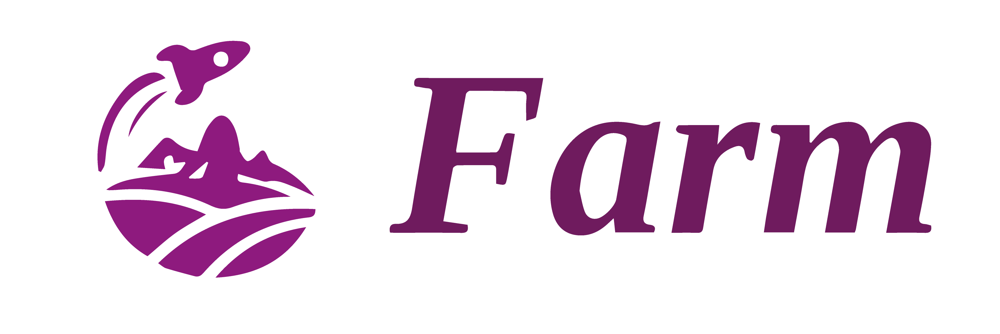

<div align="center">
  <a href="https://github.com/farm-fe/farm">
  
  </a>
  <h3>Rust native web build tool with an official Rust plugin ecosystem</h3>
  <p>
    <span>English</span> |
    <a href="https://github.com/farm-fe/farm/blob/main/README.zh-CN.md">简体中文</a>  
  </p>
  <p align="center">
    <a href="https://discord.gg/mDErq9aFnF">
      
    </a>
    <a href="https://twitter.com/FarmFe71928" > 
       
    </a>
    <a href="https://npmjs.com/package/@farmfe/core"></a>
    <a href="https://nodejs.org/en/about/releases/"></a>
  <a href="https://npmcharts.com/compare/@farmfe/core?minimal=true">
    
  </a>
  <a href="https://github.com/farm-fe/farm/blob/main/LICENSE">
    
  </a>
  <a href="https://gurubase.io/g/farm">
    
  </a>
  </p>
  <br/>
</div>

---

## Intro

Farm is a Rust native web build tool. Its compiler and built-in compilation plugins handle the module graph, transformation, bundling and optimization in Rust. Official Rust plugins extend this pipeline for frameworks, styling, assets and documentation.

Node.js provides configuration, CLI and development-server orchestration. JavaScript plugins, React rendering and application runtimes remain part of the stack where needed. Vite-compatible plugin adapters provide a migration path; they are not the definition of Farm’s architecture.

This branch contains the v2 release candidate. Source versions and plugin implementations do not establish registry availability or completed release acceptance. Use a matching verified candidate for v2 evaluation; `@latest` commands select the version currently published to the registry.

## Online experience

[](https://codesandbox.io/p/github/ErKeLost/react/main)

## Why Farm?

Farm puts the compiler and compilation extensions on a native Rust foundation, with one plugin architecture for development and production. It combines incremental compilation and configurable bundling with adapters for existing JavaScript tooling. See [Why Farm](https://farmfe.org/docs/why-farm) for architecture and migration details.

## Features

- **Rust native compilation**: a Rust compiler and built-in plugins for scripts, CSS, HTML, JSON, resolution and production optimization.
- **Official Rust plugin families**: React/Vue, Sass/Tailwind CSS, import automation, SVG/icons, data and assets, workers/Wasm, and documentation tooling. See the [plugin overview](website/docs/plugins/official-plugins/overview.md) for source scope and candidate status. Feature coverage varies by plugin.
- **Incremental workflows**: persistent caching, lazy compilation and hot updates; results depend on workload, configuration and cache state.
- **Partial bundling**: control output grouping while keeping development and production on the same compiler foundation.
- **Extensible migration**: Rust and JavaScript compilation plugins, runtime plugins and Vite-compatible adapters. Verify the hooks and framework features your project uses instead of assuming every Vite plugin is interchangeable.

V2 package publication, platform payloads and release acceptance are tracked separately from the availability of source code.

## Getting Started

Create a new Farm project with your favorite package manager:

```bash
# with npm
npm create farm@latest
# with yarn
yarn create farm@latest
# with pnpm
pnpm create farm@latest
```

Visit [Farm Documentation](https://farmfe.org) to learn more about Farm.

## Benchmark

Historical benchmark data and its workload are available in [performance-compare](https://github.com/farm-fe/performance-compare). These results are not measurements of this v2 candidate or guarantees for your project. Compare the same content, configuration, hardware and cache state when evaluating v2.

## Contribution

See [Contributing Guide](https://github.com/farm-fe/farm/blob/main/CONTRIBUTING.md).

## Chat With Us

- [Author Twitter](https://twitter.com/brightwwu46799), [Official Twitter](https://twitter.com/FarmFe71928)

- With [Discord](https://discord.gg/mDErq9aFnF)

- Wechat group

<br>

- QQ group

<br>

## Contributors

<a href="https://github.com/farm-fe/farm/graphs/contributors" target="_blank">
  <table>
    <tr>
      <th colspan="2">
        <br/>
        <br/><br/>
      </th>
    </tr>
    <tr>
      <td>
        <picture>
          <source
            media="(prefers-color-scheme: dark)"
            srcset="https://next.ossinsight.io/widgets/official/compose-org-active-contributors/thumbnail.png?activity=active&period=past_28_days&owner_id=108205785&repo_ids=507542208&image_size=2x3&color_scheme=dark"
          />
          
        </picture>
      </td>
      <td rowspan="2">
       <picture>
        <source media="(prefers-color-scheme: dark)" srcset="https://next.ossinsight.io/widgets/official/compose-org-participants-growth/thumbnail.png?activity=new&period=past_28_days&owner_id=108205785&repo_ids=507542208&image_size=4x7&color_scheme=dark">
        
      </picture>
      </td>
    </tr>
    <tr>
      <td>
        <picture>
          <source
            media="(prefers-color-scheme: dark)"
            srcset="https://next.ossinsight.io/widgets/official/compose-org-active-contributors/thumbnail.png?activity=new&period=past_28_days&owner_id=108205785&repo_ids=507542208&image_size=2x3&color_scheme=dark"
          />
          
        </picture>
      </td>
    </tr>
  </table>
</a>

## Credits

Thanks to https://github.com/tmm who donated the [farm](https://www.npmjs.com/package/farm) npm package to the Farm team.

Thanks to projects:

- The [SWC](https://github.com/swc-project/swc) project created by [@kdy1](https://github.com/kdy1), which powers Farm's code parsing, transformation and minification.

- The [NAPI-RS](https://github.com/napi-rs/napi-rs) project created by [@Brooooooklyn](https://github.com/Brooooooklyn), which powers Farm's node-binding implementation.

- The [Rollup](https://github.com/rollup/rollup) project created by [@lukastaegert](https://github.com/lukastaegert), which inspired Farm's plugin system implementation.

- The [Vite](https://github.com/vitejs/vite) project created by [Evan You](https://github.com/yyx990803), which inspired Farm's compatibility design of ecosystem.

## Author & Maintainer

Author:

- [brightwu（吴明亮）](https://github.com/wre232114)，worked at bytedance. [Twitter](https://twitter.com/brightwwu46799)

Maintainer:

- [ErKeLost](https://github.com/ErKeLost)
- [shulandmimi](https://github.com/shulandmimi)
