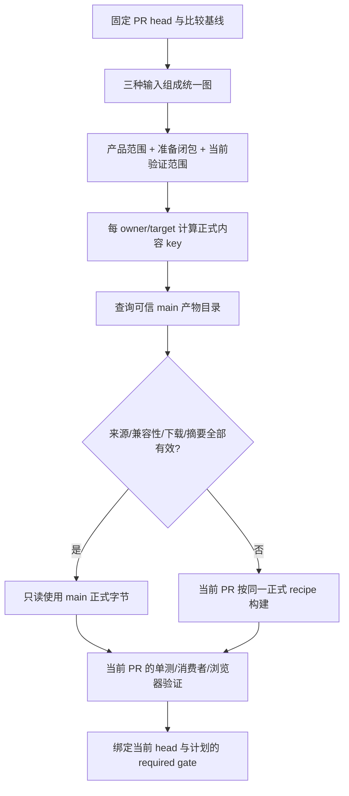
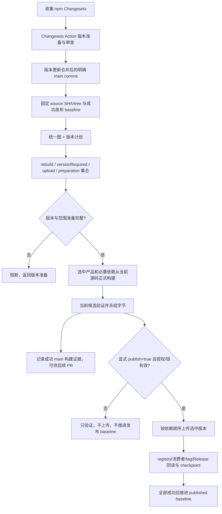

<!-- cspell:words codegen debuginfo rustflags rustup cdylib rlib napi libloading plz serde lto sse crt -->
# 统一依赖图、PR 产物复用与升版后增量发布设计

状态：**用户已批准本方案及下述 Changesets 补充，正在本地实施与验证，尚未远端启用。**

本稿以 2026-11-01 的设计讨论为准。写稿时本地实现 HEAD 为
`a752b6b09a09b3c37812bcf14961bb533186511b`，存在未提交的失败回归与测试证据。
本次只增加设计文档，不表示既有本地实现、远端 CI 或实际发布已经满足本方案。
后续用户已授权本地确认后普通推送现有 PR；不创建真实版本 PR，不执行真实合并或发布。

本稿批准后，将取代以下旧设计约束：CI/release 永不共享构建字节、仅允许文档路径触发
native 复用，以及 release 通过恢复未变化包的历史二进制准备本轮构建。
旧文档保留为历史实施记录，不能与本稿拼接成两套同时生效的规则：
[旧独立链方案](independent-incremental-chains.md)、
[旧 GNU 文档复用范围](ci-leaf-native.md)、
[旧 suite 选择](ci-suite-selection.md)、[现有发布准备](v2-auto-release.md)。

## 2026-11-01 本次已升版合并自动发布补充

本节替代下文“仅显式 dispatch / publish=true 才上传”及“#2330 不触发 Cargo”的旧限制。
用户已批准：#2330 合并 main 后发布当前已准备好的 npm / crates 版本，不再要求另一轮升版。
这不是现在执行合并或发布的授权；本轮只做本地实现、无上传验证及普通 PR 推送。

- npm：main push 固定事件 SHA → `automatic-release-source.mjs` 认证实际合并 PR →
  统一图选集 → 正式源码构建 → 当前候选/功能验证 → 锁与冲突预检 → 上传、公共回读、checkpoint。
  普通未升版 push 不授权发布。手动入口继续要求 `publish=true`，只读 producer 验证不上传。
- #2330 的受限认证绑定仓库数值 ID、原升版消费 commit、已审查 anchor、完整版本族、
  实际 merge/squash tree 与目标父提交。后续常规版本 PR 仍须 Changesets producer 和语义证明；
  title、actor 或 branch 单独都不能放行。连续 main 合并各自使用事件 SHA，不重定向最新 main。
- 两项后续修复明确计入当前未发布的 core / TailwindCSS / plugin-tools 2.0.0，
  不额外升 patch。原始 Changeset 保存在 [消费档案](consumed-changesets/2330/css-cache-recovery.md)
  和 [CLI 修复档案](consumed-changesets/2330/native-cli-paths.md)，归属与 hash 记录在
  [首次发布策略](prepared-release-2330.json)。认证同时校验 anchor 原文、归档内容和实际消费。
  用户只允许本次普通 PR Changesets 检查的已知失败；main 必须通过来源认证证明消费，
  不得忽略类型、功能、来源、冲突等失败，也不修改分支保护。
- Cargo 仍独立发布源码包。#2330 首发使用同一已审查版本族，**不以 main/head 版本差为选集**。
  普通后续版本 PR 保留版本递增选集。已存在的 3 个版本必须匹配策略内 archive checksum，
  不重新打包上传替代；其余 25 个执行默认 `cargo package` 验证、冻结、完整冲突预检和拓扑上传。
  保留版本在准备和上传前分别回读，缺失/yank/异字节均阻断。npm 发布不等待 Cargo 发布完成。
- 首次没有可信发布 baseline 时 npm 全选；不能把 PR 成品或未知历史归档当成成功 baseline。
  同一事务重跑仍只恢复原冻结字节，冻结丢失不能以重建替代可能已部分上传的包。
- CI/Unit/Docs/native 的 main 并发组包含 SHA，后一个 main 提交不取消前一个的发布功能证据。
  npm 与 Cargo 各自保留无取消的发布锁；不增加新凭据或扩大到 fork / 任意 PR 发布。
- 两个发布组显式设置 `queue: max`，避免默认单 pending 被后续普通事件替换。
  GitHub 当前最多保留 100 个 pending，满队后新 run 会取消；按开始等待时间 FIFO，不能
  当作提交顺序保证。保留 registry latest 反降级保护及固定 SHA，不自动补写被取消的发布。
- 缺少冻结候选时，首次 attempt 可准备；重试必须读取全部历史 attempt（最多 19 个）、完整
  job 列表及精确 source/repo/workflow。只有 publisher 明确 skipped 且无 steps、producer
  未成功且冻结步骤明确 skipped，才允许从尚未冻结的失败恢复。已冻结后丢档、可能上传、
  取消/未知 publisher、缺字段、截断列表均拒绝；验证依据输出到当前源 job 日志。
  这不是重建替代已部分发布的字节，两个边界必须分开。

首次上线仍须配置现有 npm/crates token 的对应包发布权限，以及 GitHub workflow 的既有 artifact
读取和 tag/Release 写权限。无凭据必须失败，不能以本地模拟作为真实 registry 发布成功证据。

## 2026-11-01 已批准的 Cargo 范围修订

本节覆盖下文较早版本中把 crates.io 纳入统一增量发布的描述。

- 本方案的增量构建、成品复用、Changesets 后发布只覆盖 **npm 包及其 native payload**。
- Cargo workspace/path/target/features/build/dev 依赖图继续完整参与 Core、Rust plugin、
  create-farm 二进制的输入闭包、ABI 兼容性与当前测试选择；不删除 Cargo 图。
- crates.io 上传不进入新 npm 增量 publisher，不等待 npm 二进制候选，也不增加多平台
  Cargo 成品构建/复用要求。Cargo 原有源码包流程及校验独立保留；不因本次范围缩减增加
  `--no-verify`、新的发布凭据或自动发布触发。
- npm Changesets Action 从 main push/显式 dispatch 准备版本，不等待 Release-plz 工作流
  完成。不再读取 crates.io 已发布状态作为 npm 升版前提；Rust 源码版本与 ABI 检查仍保留。
- npm 发布计划、归档、publisher、发布 baseline 均显式限定 `publicationScope: npm`；
  不得把混合 Cargo/npm 的旧 baseline 当作 npm-only 的已完成发布证据。
- 本地读取的 `origin/main` 为 `1d1039e7`：其 `release-plz.yaml` 只有 `release-pr`；
  当时 crates.io 上传位于 `v2-stable-release.yaml` 的 `rust` job，调用
  `v2-auto-release.mjs rust`，此前已在本 PR 的 `0a2f3e08` 退役。
  更早的 `5db8ecce^` 才有自动 `release-plz release`。这两者不是同一个入口。
  本次不擅自恢复更早的自动 release；`release-plz.yaml` 与 `release-plz.toml` 保持不变。
  源码上传职责现由 [cargo-source-release.yaml](../../.github/workflows/cargo-source-release.yaml)
  承接：保留原 main 上同仓已合并 Changesets 分支事件和并发组，现有 Cargo secret
  仅给 publisher。单独验证版本 PR 来源与语义、固定 merge tree，默认 Cargo package
  验证后冻结源码归档；无 npm/native 候选依赖，不创建 tag 或 Release。
  必要行为差异：不再使用旧全量 npm/SDK seal；改用 Cargo 自身 package 验证和原档证明。
  当前入口仅选择该受验证版本 PR 中确实提升版本的 Cargo 包；没有 Cargo 版本差异则为空。
  不扩展触发到任意 release-plz PR，不恢复早期 release-plz 自动发布。独立合并的 Cargo
  版本提案应被上传入口拒绝；这是已确认的原触发边界，不是等待新增自动发布入口的阻塞。
  提案纳入 Changesets 版本 PR 时仍须经过既有来源、版本语义与源码包校验；没有纳入的
  Cargo 版本不因 npm 发版自动获得上传授权。
  重跑缺失/过期原 artifact 一律阻断；允许原成功 producer attempt 恢复，不能重新打包
  替换部分上传事务的字节。真实双 crate 默认验证和 API/ZIP 恢复测试不代表真实 registry 发布。

## 1. 目标与明确决策

1. **一个统一图，三种共同输入**：全局目录/文件依赖、Cargo/npm 声明依赖、声明式自定义
   目录依赖。三者共同解析完整构建与验证关系，不是两层过滤，也不是不断扩充路径白名单。
2. PR 对每个 `owner × target` 查询可信 main 正式构建产物。相同产品的 CI/main 使用完全
   相同的正式 recipe；只有输入与证据完整匹配才复用。复用的是构建字节，不是当前 PR 的测试结论。
3. artifact 被删除、过期、不存在、下载失败、损坏或证据缺失，均回退当前 PR 构建。
   不能把缺失当作“不适用”，不能因此跳过 required gate。
4. **先 Changesets 升版，再 main 对 npm/native 增量构建和发布**。基于升版后的固定 main SHA 与成功发布
   baseline 计算选中集合；选中产品和必要构建依赖从当前源码走正式构建，不恢复历史成品。
5. main 本轮未选中产品不构建、不重新上传，沿用它们已发布的状态；这不叫本轮构建复用。
6. main 成功构建并验证的正式产物可供后续 PR 只读使用。PR 构建的产物绝不晋升 main 发布候选。
7. 只有 PR CI 与 main release 两个执行入口。版本准备是 main release 的前置阶段；候选构建、
   验证与发布也是同一入口内的阶段，不增加独立重复 main 构建流水线或第三条 PR release reference。

不声称不用 AST 的静态规则能绝对推断任意动态读取。目标是可检查的归属覆盖、显式补充边、
可解释的保守回退和真实执行验收，避免把无法证明的“不受影响”当作跳过依据。

## 2. 当前仓库事实与本稿的边界

- [Changesets 配置](../../.changeset/config.json) 使用 main，`updateInternalDependencies=patch`，
  没有 fixed/linked 分组，忽略 Examples、farm-docs 和 bench。已有 Changesets CLI 与 PR 检查。
- [release.yaml](../../.github/workflows/release.yaml) 当前承担 Changesets 版本 PR 准备；
  [release-plz.yaml](../../.github/workflows/release-plz.yaml) 准备 Cargo 版本提案。
  Changesets 本身不会替我们升级 Cargo manifests；继续使用现有受验证的 Cargo 提案衔接，
  但所有版本准备必须在增量构建之前完成。
- 当前 [incremental-release.yaml](../../.github/workflows/incremental-release.yaml) 接收 main push
  和显式 dispatch，存在旧 restore 路径。本稿是这些触发与执行规则的目标设计，不是现状说明。
- 当前实际 native recipe 并不统一：Core 正式构建通常用 `release-publish`，create-farm 和
  Rust plugins 用普通 `release`；插件定义的 `build:publish` 并非当前公共脚本的实际调用。
- 已有的依赖分析、来源校验、产物摘要、冻结与恢复逻辑可复用实现经验；其中与本稿冲突的
  namespace/profile 拒绝规则、文档白名单和 release 历史成品 restore 必须替换，不能并列运行。

## 3. 统一图模型：三种输入共同决定范围

节点包括源码目录、共享输入、npm/Cargo 包、生成步骤、正式产品和验证任务。
产品标识区分 Core binding、独立 Rust plugin、JS package、create-farm 及平台 payload；
私有包和构建辅助包也必须有节点，不能因为不发布而从依赖闭包消失。

边方向统一为 **消费者 → 所依赖的输入/节点**。变更影响按反向边传播；准备构建按正向边展开。
每条边包含类别、来源和原因：

| 边类别 | 含义 | 对范围的作用 |
|---|---|---|
| product | 改变产物字节、布局、ABI、版本或嵌入信息的输入 | 传播到受影响产品，改变内容指纹 |
| preparation | 执行构建需要的工具、生成步骤、私有/公共源码依赖 | 加入构建准备闭包；影响字节的工具边同时属于 product |
| validation | 测试夹具、dev dependency、浏览器场景等 | 加入当前验证集合，不自动让 Core 二进制失效 |

三种输入并行贡献边，最后只产生一个图与一份计划：

- **全局输入**：例如根锁文件、工具链、共享构建配置、执行脚本成为显式全局节点，连接所有
  相关产品/准备/验证节点。真正全局构建输入变化传播到全部产品；全局测试配置可只连接全部
  验证节点。分类必须声明，不能通过路径猜测悄悄缩小范围。初始不确定项采用全产品保守边。
- **Cargo/npm 依赖**：Cargo workspace、path、normal/build/dev、target 条件及实际 features；
  npm workspace/local、alias、file/link、dependencies/dev/peer/optional。身份使用目录与包标识，
  同名私有 Examples 不合并。build/normal 参与产品和准备，dev 至少参与验证；实际作为构建工具
  的 dev dependency 还必须进入 preparation/product。peer/optional 不能一律忽略。
- **自定义目录依赖**：补足 manifests 之外的配置、public 资源、env 目录、fixtures、生成脚本、
  runtime/HMR、共享模板、Docs/theme 等读取关系。生成输出反向绑定生成器和原始输入。
  动态路径无法收窄时，显式连接全部潜在消费者；仍无法确定则全量回退。

配置示意（目标格式，尚非现有解析器接口）：

```json
{
  "schemaVersion": 2,
  "globalInputs": [
    {"id": "rust-toolchain", "paths": ["rust-toolchain.toml", ".cargo/**"], "consumers": ["native:*"], "edges": ["product", "preparation", "validation"]},
    {"id": "test-runner", "paths": ["e2e/**"], "consumers": ["browser:*"], "edges": ["validation"]}
  ],
  "owners": [{"directory": "js-plugins/babel", "node": "npm:js-plugins/babel"}],
  "directoryDependencies": [
    {"consumer": "example:react", "paths": ["examples/react/public/**", "examples/react/farm.config.ts"], "edges": ["product", "validation"]},
    {"consumer": "npm:js-plugins/postcss", "dependency": "example:vite-adapter-vue", "edges": ["validation"]}
  ]
}
```

实施时 owners 主要从 workspace 自动枚举，custom 只补声明缺口，不手写一份重复包清单。
现有 [directory-impact-rules.json](../../scripts/directory-impact-rules.json) 是迁移起点，
其中 global/suiteGlobal 需要转换为有类型的节点/边；不能继续把它解释成两层调度流程。

### 覆盖、删除与解释

- 对比旧、新 Git tree 的实际文件和 mode；rename/delete 同时检查两端，使用旧新 owner/边的并集。
- 每个受跟踪输入必须被 owner、global 或有理由的非构建输入声明覆盖；新增目录、symlink、
  无法解析的协议、缺失自定义边目标、重复/歧义 owner 都有完整性检查。
- unknown/ambiguous 不省略工作：输出 `full-fallback`、具体路径和原因，执行全量。
  规则配置本身无效时报告契约错误并阻止 required gate 成功；普通未知路径可以全量验证，
  但不能宣称已获得精准增量覆盖。没有完整枚举能力时不得产生 selected 计划。
- 无可靠比较基线时选全量构建/验证，不通过假定空 diff 得到 no-op。
- 输出解释链：`changed path → owner/global node → edge type → affected product/test → action`。
  计划同时记录正向准备闭包、反向影响闭包、图版本与摘要。
- 真正 no-op 必须有可靠旧新快照和图完整性证据；仍执行身份/规则/required gate 合同检查。

## 4. 正式 recipe 与产物身份

统一要求是**同 owner、同 target 的 PR 和 main 正式构建参数完全一致**，不是强迫所有不同产品
使用同一种优化策略。初始建议保留当前正式构建的产品策略，将其集中声明，再让 PR 调用同一入口：

| 产品 | 正式策略起点 | PR 目标 |
|---|---|---|
| Core，常规 target | `release-publish`: opt=3、fat LTO、codegen=1、debug=false、strip=symbols、panic=abort | 完全相同 |
| create-farm / 独立 Rust plugins | 当前普通 release：opt=3、LTO=false、codegen=16、debug=false、strip=none、panic=unwind | 完全相同 |
| Windows ia32/arm64 Core | 当前普通 release、关闭 default features；arm64 codegen=256，LTO=false | 同一显式 target recipe |

这是沿用实际正式行为的迁移建议，不激活目前未调用的 plugin `build:publish`。
删除生产二进制的 CI 专用优化分叉；单元测试的 `ci-test` 可以独立存在，它不向正式产物目录提供字节。
Apple 当前 CI `strip=none` 修复证明不能把 `strip=debuginfo` 盲目带入统一 recipe；目标应分别
遵循 Core 的 symbols 与独立插件的 none，并对真实加载验收。不得只改 profile 标签。

recipe 必须展开并绑定实际值：Rust toolchain/LLVM、Node/包管理器与构建工具版本、target/host、
有效 features、opt/LTO/codegen/debug/strip/panic、RUSTFLAGS、linker/SDK/libc、镜像、生成器、
锁文件解析和版本戳。`.cargo/config.toml` 的 target flags、GNU 显式 linker、musl 和 Windows
覆盖、Zig/xwin 路由都进入正式 recipe。Linux musl 的父 release 环境覆盖不能被误认为已经覆盖
Core 自定义 profile 的显式值；实现需输出解析后的有效值并验证。

`main SHA` 是 provenance，不直接作为内容缓存 key。建议内容 key 为：

```text
hash(owner, target, output kind, product input closure,
     resolved dependency/features fingerprints, owner/payload versions,
     embedded version stamps, formal recipe hash, ABI compatibility cohort)
```

目录路径规范化后按内容和执行 mode 计算；工作目录、run ID 等非产品信息不得随意进入 key。
版本号如参与包装或嵌入则属于产品输入；初期直接绑定 owner/payload 版本，避免错误跨版本复用。
未知环境覆盖使证明无效，回退构建，而不是忽略它。

Core 是 `farmfe_node` 生成的 `@farmfe/core` binding；独立 Rust plugin 为各自 `index.farm`。
Rust plugin 的 `_core_version` 精确检查是必要条件，但 Rust trait/object、Config、SWC/toolkit
接口、编译器、features 等也影响兼容性。ABI cohort 需要绑定这些共享输入，不能仅比较 npm
版本或字符串。create-farm 的 Node-API 产品单独建模，不混入 Farm plugin ABI cohort。

## 5. PR CI 入口：按产品复用 main，始终验证当前 PR



- 查询范围是实际所需产品；仅改 JS 插件可复用匹配的 Core，构建该 JS 插件及准备依赖。
  仅改独立 Rust 插件实现、且 Core 产品闭包/ABI 未变时，可复用 main Core 并构建该插件。
  若插件变化同时改变共享 Core/ABI/features/锁文件输入，按图扩张，不能强行保留 Core。
- 每个产品可以来自不同的历史 main 构建，只要输入 key 与兼容 cohort 匹配；未被后续 main
  选中构建的产品不因为 main SHA 前进就自动失效。组合后仍验证当前 PR 的消费者兼容性。
- producer 必须来自受保护 main 的受信工作流，成功完成对应构建及候选验证；artifact 内部
  自称 `verified=true` 无效。API 身份、workflow/repository、source/tree、run/attempt/job、摘要
  共同校验；fork/PR 上传的同名产物、失败 producer 均拒绝。
- 最新相关 producer attempt 失败时不回退旧 attempt 的成功掩盖失败。解析一次候选目录视图并
  固定 artifact ID/attempt，避免下载中指针漂移。历史成功产品尚未被新一次构建替代与失败重跑
  是不同情况，不能混为“总挑一个旧成功”。
- artifact 过期、被清理、404、不可下载、损坏、成员/摘要不符、证据不齐、recipe/ABI 不匹配：
  记录 cache miss/rejection 原因并构建当前产品。目录缓存声称存在不等于实际可下载。
  不增加凭据或绕过拒绝访问；无法完成当前授权构建则 gate 失败，而不是 skip。
- 复用不继承当前测试通过状态。当前计划中的 TS、Rust Unit、Docs、E2E、性能等任务必须真实执行；
  若某验证任务被图判为不适用，需要可验证的图证据，不能以二进制命中为理由省略。
- PR 产物只能服务本次受约束的 CI/重跑，不能更新可信 main 目录、published baseline 或发布归档。

产物目录记录示意（目标格式，以下摘要为说明性占位符）：

```json
{
  "schemaVersion": 2,
  "owner": "@farmfe/core",
  "target": "aarch64-apple-darwin",
  "contentKey": "sha256:...",
  "recipeHash": "sha256:...",
  "inputClosureHash": "sha256:...",
  "abiCohort": "sha256:...",
  "versionsHash": "sha256:...",
  "producer": {"sourceSHA": "<main commit>", "tree": "<tree>", "runId": "123", "attempt": 1, "job": "core-darwin", "workflow": "incremental-release.yaml"},
  "artifact": {"id": "456", "archiveSha256": "...", "expiresAt": "<timestamp>"},
  "files": [{"path": "farm.darwin-arm64.node", "sha256": "..."}],
  "validationReceiptHash": "sha256:..."
}
```

有效性来自独立来源校验，不来自 JSON 字段。manifest 不授予发布权限。

### Changesets 版本 PR 的轻量通道（批准补充）

版本准备先运行官方 Changesets Action。由可信 Action 创建的纯升版 PR 可以跳过重型 CI，
但轻量分类与稳定名称的 required gate 始终执行，成功原因明确记录为经过验证的纯版本更新。
不能只凭标题、分支、actor 名称或文件路径判定。必须绑定正确仓库/base、真实 bot 身份、
可信工作流的成功 run/attempt 与精确 head，并对实际 diff 进行语义验证：包版本前进、内部
依赖版本同步、对应 lock 更新、changelog 与 Changesets 消费；Cargo 联动同样验证版本语义。
源码、scripts/workflow/config/toolchain 变化、第三方依赖新增/删除/升级、重复版本、fork、
伪造 bot 或缺少来源证据一律走正常 CI。版本 PR 合并后才进入正式增量 release。
不得修改分支保护或权限来消除 pending；required gate 必须明确校验 heavy jobs 跳过理由。

## 6. main release 入口：Changesets 在前，选中产品实际增量构建



推荐触发策略：普通 main push 运行正常 CI，并可进入无发布权限的版本准备；**不自动启动正式
上传，也不额外重复全套 main 正式构建**。经审查的版本更新 commit 合并后，进入这个唯一 main
release 入口，默认 `publish=false`。同一固定候选经显式授权才上传。main 普通 CI 可执行 PR
入口的验证逻辑，但不能仅凭普通 CI 成功替代正式 producer 目录证据。

没有版本更新而需验证 recipe 的情况，允许显式选择固定 main SHA 运行同一入口的只验证模式；
不新增第三条构建流水线，不因任何 main push 自动发布。

### 版本准备的顺序与仓库适配

1. 功能 PR 提交 Changesets，Cargo 变化有受验证的版本提案；版本准备工作流没有 registry 写权限。
2. 使用官方 Changesets 计算并执行 npm 升版，衔接已有 Cargo 提案校验和消费逻辑，更新包版本、
   内部依赖约束、native owner/payload 版本、Cargo manifests/lock、pnpm lock、changelog 与 inventory。
   Cargo 不是由 Changesets 原生自动升级；保留现有适配器的验证责任。
3. 形成可审查的版本 PR，并记录 consumed Changesets/版本计划。**升版合并后**的准确 commit
   才是 release 构建源；不能先构建旧版本，再修改 manifest 后冒充同一候选。
4. 当前 Cargo/Changesets 两个准备工作流需要汇合到同一版本完成证据；不要求先把两个动作物理合成
   一个文件，但不能在任一版本准备尚未完成时进入构建/发布。禁止发布时临时补版本。

### 选集与构建语义

- 比较基准为最近成功发布且回读验证的 baseline，而不是“上次任意 main 构建”。首发无成功
  published baseline，完整构建已批准的发布 family 与必要依赖；不能假设 registry 为空，仍做冲突预检。
- `rebuild` 是需要正式构建的产品；`preparation` 是它们的源码构建前置闭包；`versionRequired`
  是尚缺的版本更新；`upload` 是本轮实际应发布的新版本集合。这四者分开校验。
- **本轮选中的产品每次都走当前源码的正式构建入口。**不 restore main 旧 artifact，不使用 PR
  artifact，不用旧 registry 成品填充选中产品或其 workspace 构建准备。准备闭包内未升版的包可以
  从当前源码构建用于验证，但不因此加入 upload。
- 允许正常 Cargo 编译/下载缓存及 pnpm store；它们是构建工具缓存，不是跳过选中产品生产步骤的
  整包成品复用。每个选中产品必须有当前计划的实际构建记录、有效输入与本次输出摘要。
- 未选中产品不构建、不重复上传，其原有发布状态保留。消费者测试可以从 registry 安装既有依赖，
  但该读取属于消费者验证，不能反向冒充本轮 producer 输出。
- global/recipe 变化可导致广泛 rebuild，但不自动意味着全部升版/上传。若同版本重建产生与
  已发布原始 archive 不同的字节，阻断发布，返回 Changesets/Cargo 版本准备；不得覆盖旧版本。
  比较旧 archive 摘要是不可变性检查，不是恢复历史二进制参与当前构建。
- recipe-only、无上传的成功验证可记录构建证据，**不能推进 published baseline**。需要补版本
  的失败候选也不能凭“构建完成”成为成功候选目录记录。
- no-op 只有在完整图、可靠 baseline 和版本计划均证明没有 rebuild/upload 时成立。
  仍输出当前固定 source 的计划与 gate 结果，不虚构一次新发布。

### 两种 baseline 与同一事务恢复

`main build catalog` 记录成功 main 正式构建的产品，可按 key 被后续 PR 只读消费。
`published baseline` 记录已真实发布并回读通过的版本/摘要/来源，是下一次 main release 的比较基准。
两者均由同一 main release 入口产生，但不能互相代替，不额外引入一个 main producer 流水线。

发布前冻结完整事务：source/tree、baseline、plan、版本集合、recipe、artifact/archive 摘要和验证
收据。事务锁覆盖最终预检到发布完成，使用 fencing token 防止过期 worker 写入；取得锁后重新检查
baseline 与 registry 冲突。发现 baseline 已前进，未上传的旧计划必须重新规划/验证，不能继续用旧选择。

部分上传后重试属于**同一发布事务恢复**：使用该事务原已验证并冻结的字节，按 checkpoint 回读
已上传项，再上传缺失项，不重新构建替换字节。不将该机制包装成跨运行增量构建复用。
冻结归档缺失时先从事务的持久、完整性校验备份恢复；若已部分发布且无法恢复准确原档，阻断并
报告，不能套用 PR 的“缺 artifact 则重建”规则。未上传的候选可废弃并建立新事务。

仅所有选中版本、公共消费者、tag/Release 回读全部通过后更新 published baseline。
上传、tag/Release、baseline 写入均要求显式授权；dry-run 没有这些副作用。

## 7. 连续合并、多个 PR 与场景

PR 固定 head、比较基线及目录解析视图。多个 PR 可以只读消费同一 main 产品；PR 的验证收据分别
绑定各自 head，不能互用。连续 main 合并产生不同 source：已开始事务不切换到最新 main；版本 PR
过时应在构建前重新准备。锁获取后发现发布基准变化，重新计算覆盖该变化的计划。尚未上传的过时候选
可以被新计划替代；已开始上传的事务必须先按冻结状态恢复/完成，不能被另一次构建替换。

| 场景 | PR CI | main release（升版后） |
|---|---|---|
| 仅普通 JS 插件 src | 图选择插件/消费者测试；Core key 匹配则复用，否则构建 | 构建该发布产品及源码准备闭包，只上传版本计划选中项 |
| 仅独立 Rust 插件实现 | Core 输入/ABI 不变时复用 main Core，重建插件并组合验证 | 重建选中插件各 target；Core 不在闭包则不构建、不上传 |
| Core/compiler 或共享 ABI 变化 | 扩张 Core/兼容 cohort/消费者；失配产品重建 | 升版计划覆盖受影响 family 后构建、验证并发布 |
| 真正全局构建输入变化 | 图扩张全产品，recipe/key 失配则重建 | 全部受影响产品实际构建；不自动全部上传，同版本异字节阻断 |
| 仅验证夹具/测试配置 | 执行受影响验证；产品指纹不变可复用 | 无产品/版本 delta 时不构建发布；需要的验证仍执行 |
| artifact 被清理或过期 | 当前所需产品重建，验证不跳过 | 不依赖旧 artifact，按选集构建；同事务冻结归档缺失另按恢复规则处理 |
| 仅版本更新 | 版本戳/包装指纹变化的产品重建并验证 | 使用升版后 SHA 构建新版本，不重贴旧 archive 的版本 |
| 首次无成功发布 baseline | 无有效图基线则全量；无可信产物则构建 | 完整 family 构建，仍预检 registry 冲突 |
| recipe-only、无版本 delta | 正式 key 改变，失配则构建 | 可只验证重建；不上传、不推进 published baseline |
| 删除/rename/未知目录 | 旧新图并集；未知全量并解释 | 相同传播规则；删除已发布包需显式退役设计，不能默默遗失 |
| 多 PR / 连续 main 合并 | 产品按 key 匹配，当前 PR 各自验证 | 固定版本 commit，锁后重查 baseline，部分发布按同事务恢复 |

## 8. 实施落点与迁移

以下为已批准的实施清单；是否完成以对应源码和验证记录为准：

| 落点 | 计划职责 |
|---|---|
| `scripts/directory-impact-rules.json` 及图解析器 | 三种输入、边类别、完整归属、旧新图并集、解释与 fallback |
| `scripts/ci-impact-plan.py` / `incremental-chain-plan.py` / `ci-suite-impact.mjs` | 使用同一图事实，输出产品/准备/验证集合，消除 shadow 与真实执行的分歧 |
| `ci-suite-preparation.mjs` 与实际测试入口 | 根据计划执行闭包；空集合有证明；required gate 校验实际执行收据 |
| `Cargo.toml`、公共 native 脚本、package scripts、平台工作流 | 集中正式 recipe，PR/main 同 owner/target 完全一致，展开环境与平台覆盖 |
| native proof/capture/evidence、产物目录与 CI resolver | 逐产品 key、main 来源、下载完整性、过期 miss、ABI cohort、attempt 规则 |
| Changesets/Cargo 版本准备与 inventory 检查 | 保证升版在前，固定版本 commit，保持版本/payload/lock 一致 |
| `incremental-release-entry.py` / producer / workflow | 移除历史成品构建 restore；按选集源码构建；分离 build 与 publish baseline |
| 发布 checkpoint/fence/公共回读 | 保留同事务冻结恢复、不可变版本和显式发布权限 |
| 旧文档与旧恢复入口 | 批准实施时标记迁移/退役，不留可绕过新 gate 的备用全量发布路线 |

旧 artifact 不因名称相似自动兼容新 recipe；缺新 manifest/来源/有效指纹时按 miss 处理。
不删除旧归档、已发布记录或恢复 checkpoint 来“清理迁移”。保留正在恢复的旧事务边界，避免新规则
改变已经上传的冻结字节。新的 main 正式候选成功后逐步填充产品目录；首次 PR miss 的构建成本正常接受。

## 9. 验收矩阵与一次性落地顺序

| 验收类别 | 必须覆盖 |
|---|---|
| 图完整性 | global、自定义配置/public/fixtures/生成器、Cargo target/features/build/dev、npm alias/file/link/peer/optional、私有包、同名/歧义、unknown |
| 变更传播 | 普通 JS/Rust 插件、Core、shared runtime/HMR、锁文件、版本、rename/delete/mode、空 diff、旧新依赖边 |
| 真实调度 | 计划选集等于实际 build/test IDs；准备闭包拓扑排序；未知全量；空集合与 skip 不能伪造成功；required gate 完整 |
| PR 复用 | 相同 main 内容 key 命中；main SHA 不同但内容兼容；仅插件变更复用 Core；实际重建插件后消费者测试 |
| miss/拒绝 | artifact 清理/过期/404/下载失败/损坏、摘要/成员不符、假 producer、PR 同名产物、recipe/ABI/features/toolchain/版本戳不符 |
| attempt/并发 | 最新 attempt 失败不借旧成功；目录视图固定；多个 PR 分别验收；连续 main 合并与发布锁/fence |
| 发布范围 | Changesets 先升版；仅选中产品及源码准备构建；没有 historical restore；未选中不上传；首次完整构建；版本冲突 |
| 不可变性/恢复 | 同版本异字节阻断；recipe-only 不推进发布 baseline；部分上传使用原冻结字节；冻结归档缺失阻断；公共回读后才成功 |
| 平台与功能 | Core 与独立插件真实加载、Rust/TS 单测、完整 Examples/E2E、Docs、create-farm；每目标正式 recipe 参数一致 |
| 性能 | 记录实际冷热样本、样本数、资源数据和是否有 exact-base 对照；单独说明 HMR 是否采样，不用 job 时长代替性能结论 |

实施顺序：

1. 用户 review 本稿并确认范围与正式 recipe 表，冻结设计决策。
2. 一次性完成统一图/recipe/目录协议/两个执行入口及迁移，先本地模拟矩阵验证所有契约，
   不边改边反复远端 dispatch。
3. 在隔离 cows 工作区执行一次完整本机产品验收；真实失败先修复并针对性复测，再汇总最终代码
   对应的完整证据。跨平台无法本机执行的项明确列出，不伪造验证。
4. 审查最终 diff、计划解释、命中/回退记录、构建/验证/发布范围和恢复证据；得到推送授权后
   集中一次普通 push 验证远端必要平台。不 force push、不 merge、不真实发布来代替测试。
5. 上线先验证固定 main 的无上传候选和 PR 只读复用；真实发布仍要求单独显式授权。

本稿非目标：AST/任意源码动态读取推导、跳过当前 PR 验证、PR 产物晋升发布、重新发布未变化版本、
把编译缓存当发布产物、增加第三条重复发布链、自动修改凭据/权限、为提高命中率降低来源或 ABI 校验。

## 10. 设计批准记录（不代表验收通过）

- [x] 三种依赖来源共同组成统一图，product/preparation/validation 含义与 fallback 可接受。
- [x] 同 owner/target 的 PR/main 正式参数一致；保留实际正式产品策略而非盲目统一所有 owner。
- [x] PR artifact 缺失必须重建，main release 自身不恢复历史成品。
- [x] npm Changesets 版本准备先完成，固定升版后的 main SHA 再规划/构建/发布；crates.io 独立。
- [x] 两种 baseline、显式 publish、同事务恢复与跨运行复用的边界清楚。
- [x] 接受上述验收和集中实施顺序；**用户已批准本地实施与真实验证；本记录不代表验收通过或发布授权。**


### Independent type and Changesets checks

Type checking and Changesets policy run as separate jobs. All three primary
platform pipelines depend on the actual `Type Check` job, never on Changesets
policy or its compatibility context. A Changesets failure therefore does not
skip native builds or current TypeScript/Examples validation. A real type error
still prevents those pipelines from starting.

`Changesets Check` retains the existing policy command and failure semantics.
The final product execution gate excludes Changesets policy so it reaches actual
suite evidence validation when product dependencies pass. Only a verified pure
version PR may use its explicit metadata-only skip; no general error waiver or
title/branch exception is introduced. For the approved consumption in #2330,
the standalone Changesets check may remain failed; it is not reported as success.

The user approved removing obsolete required-name compatibility jobs. Removed:

- `Type Check & Changesets` (the combined compatibility job).
- Three `Examples Test (...-latest, ABI)` compatibility contexts.
- Three `Typescript Test (...-latest, ABI)` compatibility contexts.
- `Test - ubuntu-latest` (the compatibility wrapper around the Rust matrix).

Actual TypeScript/Examples leaf jobs under each primary platform, native builds,
Docs acceptance, Rust check/test matrix, performance sampling/aggregation, and
`Incremental CI execution gate` remain. Meaningful primary-chain summaries remain
because consumers depend on their actual completion; they are not old-name aliases.

Selection/materialization evidence and CI/release functional acceptance now
require the actual `Type Check` producer. Old combined-context receipts cannot
substitute for it. No source, attempt, receipt, performance or publication-safety
check is removed with the naming adapters.

Suggested future required checks (recommendation only; not configured here):

| Scope | Current real check names |
| --- | --- |
| Product execution and selected suite evidence | `Type Check`; `Incremental CI execution gate` |
| Docs and performance acceptance | `Docs CI quality checks`; `Aggregate informational performance report` |
| Rust checks and tests | `Check`; `Test - ubuntu-24.04`; `Test - macos-latest`; `Test - windows-latest` |
| Static quality | `Rust Code Lint`; `TS Code Lint`; `Spell`; `Validating PR title` |
| Changesets policy, separately reviewed | `Changesets Check` (keep #2330's approved consumed-version exception explicit) |

Before applying the list, match names and producing workflows against actual
Actions results, including authenticated version-only PRs: their heavy jobs are
planned skips and the execution gate must verify the classification proof.
Existing repository required settings may temporarily wait for removed names.
The user will update them separately; this change does not edit protection,
rule sets, permissions, or mark an absent/failed check successful.


### Docs consumption of the current platform producer

Linux and Windows Docs now start inside their matching primary platform chain
after that native producer succeeds, in parallel with TypeScript and Examples.
They do not wait for the other primary platform or the secondary native matrix.
The existing top-level Docs context aggregates the two platform chains.

The native producer seals Core plus the eleven Docs plugin payloads with the
current source SHA/tree, actual run attempt, fixed toolchain, formal recipe,
Cargo/npm dependency fingerprints, ABI cohort, and individual byte digests.
The consumer authenticates the latest actual successful producer and its upload
step, validates the artifact archive and every member, then materializes only
matching owners. This is delivery within the current CI run; selection of older
main products remains exclusively in the existing formal producer resolver.

Missing/expired/deleted artifacts or incompatible owner fingerprints cause only
the required owners to be built with the shared formal recipe. The localized
source build uses the release recipe's existing owner-scope guard; it does not
run publication or change the Docs CI acceptance role. Source/attempt/digest
errors and failed/skipped producers are rejected. Fork PRs and standalone Docs
retain source building without inheriting artifact trust. Reused bytes are
guarded before and after any fallback and throughout the existing Docs checks.

JS packages, the website, SSR, browser, notices, and Docs functional validation
remain mandatory. Cargo unit/integration tests still compile their own test
binaries; native payload reuse does not replace those tests or reuse results.
The delivery bundle duplicates twelve already-uploaded payloads for bounded,
atomic verification; it does not add another native compilation.

Changesets policy is also independent of the final product execution gate. A
policy failure must not prevent collection and validation of the six current
TS/browser receipts, selected files, per-file case counts, or build coverage.
The six legacy TS/Examples contexts depend on this real product evidence gate.
Changesets Check and the legacy combined policy context still report policy
failure explicitly; no branch protection or policy result is rewritten.


### Committed source-plan coverage and historical snapshots

The live shadow planner uses the shared directory-identity graph for merge-base,
base, head and tested snapshots. Source proof fingerprints bind all committed
paths, modes and file hashes plus the graph, rule provenance and dependency
closure hashes. They are conservative source proofs, not reusable binary keys.

If a historical snapshot predates the committed directory rules, the explicit
`all-committed-inputs-v1` analysis policy connects every node to a repository-wide
input node. Every product/preparation/validation fingerprint includes the whole
historical snapshot and the plan requires full execution. No current custom edge
is claimed to have existed historically. The tested snapshot must contain valid
committed rules; ambiguity and invalid source records still fail closed.

For main functional acceptance, the release verifier independently recomputes
this plan from the fixed Git commits and compares the entire result, after
binding the already authenticated run identity. A self-consistent plan hash or
`sourceInputProofComplete` flag alone is insufficient. Coverage means committed
inputs only, not complete environment proof; skip/reuse remain unauthorized.
